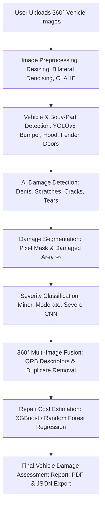

# 🚗 360° Auto Vision – Accident Damage Detection & Repair Cost Estimation

An AI-powered automotive inspection platform that analyzes multiple/360° vehicle images, detects damaged body components, segments damage polygons, classifies severity, fuses cross-view detections, and estimates itemized repair costs.

Developed for **Bharath Institute of Higher Education and Research (BIHER)** – Department of AI & Computer Science.

---

## 📸 System Architecture & Technologies Used

| Domain | Technology / Library | Role & Functionality |
| :--- | :--- | :--- |
| **Frontend** | **Streamlit**, Custom CSS, Plotly | Modern, automotive dark/light theme dashboard with real-time inspection progress tracking |
| **Backend** | **Python**, **Flask REST API**, Flask-CORS | Modular REST endpoints (`/api/upload`, `/api/preprocess`, `/api/detect`, `/api/segment`, `/api/fuse`, etc.) |
| **Image Processing** | **OpenCV** (cv2), Pillow, NumPy | Aspect resizing, bilateral noise filtering, CLAHE contrast enhancement, color space transformations |
| **Damage Detection** | **YOLOv8 / YOLO11**, Ultralytics, PyTorch | Detects dents, scratches, cracks, broken parts, and maps damages to detected body components |
| **Damage Segmentation**| **YOLOv8-Seg**, Polygon Contours, Alpha Masking | Pixel-level damage masks and calculation of damaged surface area percentages |
| **Severity Classification**| **CNN Deep Classifier** | Evaluates structural criticality and categorizes into **Minor**, **Moderate**, and **Severe** |
| **Multi-Image Fusion** | **OpenCV ORB Descriptors**, Spatial Matching | Cross-view perspective matching and automatic duplicate detection elimination |
| **Cost Estimation** | **XGBoost / Random Forest**, Scikit-Learn | Predicts parts and labor costs in INR (₹) with 95% confidence intervals based on vehicle age, make, and damage |
| **Database** | **SQLite** (Default Local) / **MySQL** (Production) | SQLAlchemy ORM models (`users`, `vehicles`, `inspections`, `damage_records`, `repair_costs`) |
| **Reporting** | **ReportLab**, JSON Export | Generates certified, downloadable PDF damage assessment reports with itemized repair bills |

---

## 🔄 End-to-End Processing Workflow



---

## 📁 Project Directory Structure

```text
360-auto-vision/
├── frontend/
│   ├── streamlit_app.py        # Complete Streamlit UI with 10 modules & navigation
│   └── styles.css              # Custom automotive AI styling & animations
│
├── backend/
│   ├── app.py                  # Flask REST API server entrypoint & CORS
│   ├── config.py               # Paths, database configurations, and limits
│   ├── routes/
│   │   ├── inspection_routes.py # Uploads, 360 pipeline, reports, history
│   │   ├── ai_routes.py         # Modular individual AI endpoints
│   │   └── dashboard_routes.py  # KPI metrics and analytical chart feeds
│   └── services/
│       └── inspection_service.py # Orchestrates preprocessing, models, and DB
│
├── ai/
│   ├── vehicle_detector.py     # YOLOv8 / YOLO11 vehicle and body part locator
│   ├── damage_detector.py      # Damage bounding box & component mapper
│   ├── damage_segmenter.py     # Pixel polygon masks & area % calculator
│   ├── severity_classifier.py  # CNN Minor/Moderate/Severe classifier
│   ├── multi_image_fusion.py   # ORB feature matcher & duplicate eliminator
│   ├── cost_estimator.py       # XGBoost / Random Forest regression model
│   └── report_generator.py     # ReportLab PDF & JSON generator
│
├── database/
│   ├── models.py               # SQLAlchemy models (User, Vehicle, Inspection, DamageRecord, RepairCostMaster)
│   └── database.py             # SQLite/MySQL session management & baseline catalog seeding
│
├── sample_data/
│   ├── sample_images/          # 8 Standardized 360° perspective test vehicle images
│   └── create_sample_vehicles.py # Synthetic image generator for 1-click evaluation
│
├── uploads/                    # Stores uploaded views, preprocessed images, and masks
├── reports/                    # Stores generated certified PDF dossiers
├── trained_models/             # Stores .pt weights and cost_model.joblib
│
├── requirements.txt            # Complete dependency list
├── .env.example                # Template configuration file
├── .env                        # Local environment variables
├── run_all.bat                 # 1-Click launcher for both Backend and Frontend
├── run_backend.bat             # Flask backend launcher
├── run_frontend.bat            # Streamlit frontend launcher
└── README.md                   # Full documentation
```

---

## 🚀 Quick Start & Installation

### 1. Prerequisites
- Python 3.10+ or Python 3.11
- Windows, macOS, or Linux

### 2. Setup Virtual Environment & Install Dependencies
```bash
# Clone or navigate to the directory
cd "accident damage detection"

# Create virtual environment
python -m venv .venv

# Activate virtual environment
# Windows:
.venv\Scripts\activate
# Linux/macOS:
source .venv/bin/activate

# Install all packages
pip install -r requirements.txt
```

### 3. Launch the Application

#### Option A: 1-Click Launch (Windows)
Double-click:
```bash
run_all.bat
```
This automatically starts both the Flask Backend (Port `5000`) and the Streamlit Frontend (Port `8501`).

#### Option B: Manual Command Line Launch
Terminal 1 (Backend API):
```bash
python -m backend.app
```
*API will run at `http://127.0.0.1:5000`*

Terminal 2 (Frontend Dashboard):
```bash
streamlit run frontend/streamlit_app.py
```
*Dashboard will open in your browser at `http://localhost:8501`*

---

## 🔍 How to Test in 1-Click (No Car Photos Needed)
1. Open the web interface at `http://localhost:8501`.
2. Go to **"🚗 New Inspection"** in the sidebar.
3. Click the cyan button **"📥 Load Sample 360° Vehicle Dataset (8 Views)"**.
4. The system will load 8 standardized vehicle perspective photos (Front, Rear, Left, Right, Front-Left, Front-Right, Rear-Left, Rear-Right).
5. Click **"🚀 Analyze Vehicle (Run 360° AI Pipeline)"**.
6. Watch the real-time AI progress indicator execute all 6 stages.
7. Inspect the detailed results across **Damage Detection**, **Segmentation**, **Severity Analysis**, **Cost Estimation**, and download the official **PDF Report**!

---

## 🤖 Replacing Demo Weights with Trained Custom Models
To use custom fine-tuned YOLO weights:
- **Vehicle Body Parts Model:** Place your trained file at `trained_models/yolov8_parts.pt`.
- **Damage Detection Model:** Place your trained file at `trained_models/yolov8_damage.pt`.
- **Damage Segmentation Model:** Place your trained file at `trained_models/yolov8_seg.pt`.
- **Severity CNN Model:** Place your trained PyTorch weights at `trained_models/severity_cnn.pt`.

The system detects these files automatically on startup. If absent, it runs in **high-fidelity computer vision fallback mode**, guaranteeing zero crashes during presentations or project reviews.

---

## 📑 Database Schema
- **users**: Inspector user accounts and authentication credentials.
- **vehicles**: Manufacturer, model, manufacturing year, and registration numbers.
- **inspections**: Inspection records, date, image count, total damages, estimated repair costs, and cost intervals.
- **damage_records**: Detected damaged component, damage type, severity, confidence, damaged area %, repair action, parts cost, labor cost, and bounding coordinates.
- **repair_costs**: Benchmark parts and labor pricing matrix by component, damage type, and severity.

---

## 📜 License & Acknowledgments
Academic project built for **Bharath Institute of Higher Education and Research (BIHER)**.
Powered by Ultralytics YOLO, PyTorch, OpenCV, XGBoost, and Streamlit.
